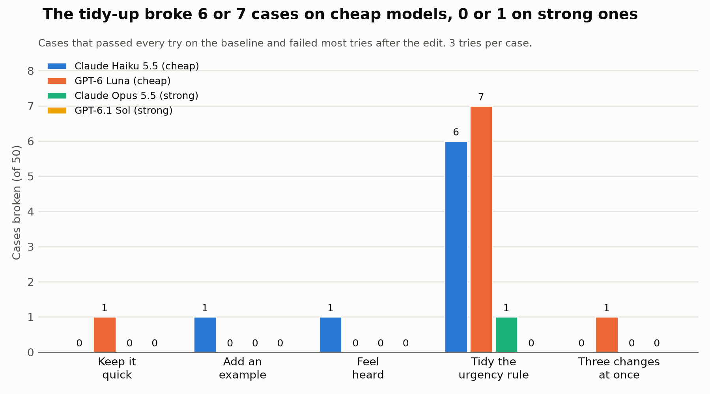
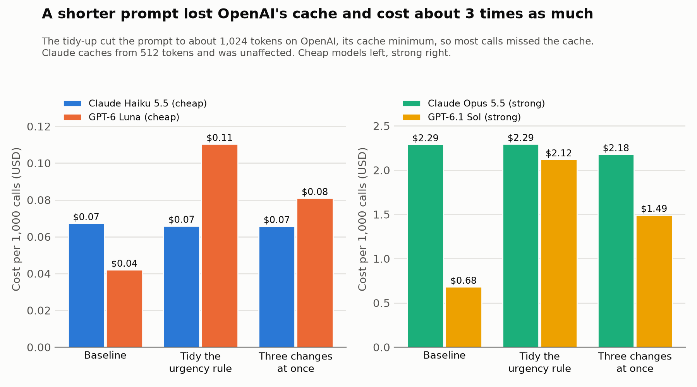

# 01 · prompt-regression-evals

An eval suite and CI gate that catch regressions when a prompt changes.

The feature under test is one model call that triages a customer support message into JSON: category, urgency, whether a refund was requested, and the invoice number. Code then decides whether a person should check the answer.

The suite runs 50 hand-labelled tickets through the feature and repeats each one three times:
- 40 visible tickets;
- 10 held-out tickets, written by a second author and never read while the prompts are edited.

It compares every edited prompt with the baseline on four models: a cheap one and a strong one (a step below the flagship) from each of two vendors. Those are Claude Haiku 5.5 and Claude Opus 5.5 from Anthropic, and GPT-6 Luna and GPT-6.1 Sol from OpenAI.

On a pull request that changes a prompt, the same check runs in GitHub Actions and blocks the merge if a ticket broke.

The problem it addresses is set out in [PROBLEM.md](PROBLEM.md). The design is in [SOLUTION.md](SOLUTION.md).

## Result

From [`runs/main/`](runs/main/): 3,600 calls on four models, 0 errors, $3.07, from commit `2e85e7d`. Full tables in [report.md](runs/main/report.md) and [review.md](runs/main/review.md).

**One readability edit broke 6 or 7 cases on the cheap models, and 0 or 1 on the strong ones.** `v5_tidy_urgency` shortened the urgency definitions. Haiku and Luna then rated tickets about money taken wrongly (double charges, a charge after cancelling, overbilled seats) as medium or low instead of high. Opus broke one of those tickets. Sol broke none.



| Edit | Haiku 5.5 | GPT-6 Luna | Opus 5.5 | GPT-6.1 Sol |
|---|---|---|---|---|
| `v2_keep_it_quick` | 0 | 1 | 0 | 0 |
| `v3_add_example` | 1 | 0 | 0 | 0 |
| `v4_feel_heard` | 1 | 0 | 0 | 0 |
| `v5_tidy_urgency` | 6 | 7 | 1 | 0 |
| `v6_bundled_pr` | 0 | 1 | 0 | 0 |

The gate failed 9 of these 20 model and edit pairs. On the unchanged prompt, all four models are within 2.5 points of each other on the visible tickets (95.0% to 97.5%). The difference between cheap and strong models shows up when a prompt edit goes wrong, not on the baseline.

**The same edit tripled the OpenAI bill.** It cut the prompt to about 1,024 tokens on OpenAI, its cache minimum, so most calls missed the cache. Sol went from $0.68 to $2.12 per 1,000 calls, and Luna from $0.04 to $0.11. Claude caches from 512 tokens and was unaffected. On Sol, the edit broke no cases, so only a cost limit (`--max-cost-per-call`) would have caught it.



**The held-out set exposed labels, not prompts.** Every model passed 5 of the 10 held-out tickets on every prompt version. On the other 5, all four models, from both vendors, gave the same answer on every call, and it differs from the expected answer. The expected answers are kept as first written, so the held-out pass rate stays at 50%.

The first run, on the first version of the prompts, is kept in [`runs/round1/`](runs/round1/). The predictions written before each run are in [PREDICTIONS.md](PREDICTIONS.md).

## Run it

You need Python 3.11 or later and [uv](https://docs.astral.sh/uv/getting-started/installation/).

```bash
git clone https://github.com/lawrence-dass/ai-engineering-lab.git
cd ai-engineering-lab/01-prompt-regression-evals
uv sync --locked
```

### Free: the harness tests

No API key, no model calls, no cost. They use a stand-in for the model and take about a second.

```bash
uv run pytest
```

### Paid: runs against the models

These call the Claude and OpenAI APIs and cost money. Set `ANTHROPIC_API_KEY` for the Claude models and `OPENAI_API_KEY` for the OpenAI ones, either with `export` or by copying `.env.example` to `.env` and adding `--env-file .env` after `uv run`. A run only needs the key for the models it names.

Start with the pilot. It makes 5 calls per model on the baseline prompt and prints what they cost.

```bash
uv run python -m evals.run --run pilot --models haiku luna --versions v1_baseline --limit 5 --reps 1
```

The full run is 3,600 calls: 4 models, 6 prompt versions, 50 cases, 3 repetitions. Run it in two stages into the same folder, the cheap models first.

```bash
uv run python -m evals.run --run main --models haiku luna   # 1,800 calls, cheap models
uv run python -m evals.run --run main --models opus sol     # 1,800 calls, strong models
```

A rerun of the same command skips finished calls and retries failed ones. `--budget-usd` stops a run from starting new calls once it has spent that much.

### Reports, from the saved rows, with no model calls

```bash
uv run python -m evals.report --run main           # pass rates, cost per correct ticket, what each edit broke
uv run python -m evals.report --run main --gate    # exits 1 if the gate fails
uv run python -m evals.review --run main           # which wrong answers a person would have seen
```

The gate fails when any of these holds:
- a case broke (`--max-broken`, default 0);
- an edit rated any case less urgent than it is (`--max-urgency-downgrades`, default 0, checked separately from broken cases);
- the average cost per call is above a limit (`--max-cost-per-call`, off by default);
- the evidence is incomplete.

### Adding test cases without code

Fill in a spreadsheet with the columns `id, tags, ticket, category, urgency, refund_requested, invoice_id`, then import it:

```bash
uv run python -m evals.import_cases cases/heldout.csv cases/heldout.jsonl
```

Every row is checked against the same rules the suite uses, and nothing is written unless all rows pass.

### In CI

`.github/workflows/01-prompt-regression-evals.yml` has two jobs:

| Job | When | What |
|---|---|---|
| `test` | Every push and pull request | The free harness tests |
| `prompt-gate` | Pull requests | Finds the prompt files the pull request changed (`evals/ci.py`) and runs them with the baseline on Haiku and Luna, about $0.15 a run. Then applies the gate. If the production prompt itself changed, its new text is compared with the copy on the base branch |

`prompt-gate` needs `ANTHROPIC_API_KEY` and `OPENAI_API_KEY` as repository secrets.

## Evidence

Every run writes these files to `runs/<name>/`:

| File | What it holds |
|---|---|
| `results.jsonl` | One graded row per finished call, including the review decision and cache tokens |
| `errors.jsonl` | Calls that failed before giving a gradable answer |
| `report.md` | The comparison against the baseline, written by `evals.report` |
| `review.md` | How many wrong answers the review rule caught, written by `evals.review` |
| `manifest.json` | The code commit, the model IDs requested and the ones that answered, run settings, the prices used for cost, and a history of every invocation |

`runs/main/` is the run behind the result above. `runs/round1/` is the first run, on the first version of the prompts, kept as a record. Pilot runs are ignored by git.

## How it works

| File | What it does |
|---|---|
| `PROBLEM.md` | The problem this experiment addresses, its parts, scope and success criteria |
| `SOLUTION.md` | How the suite works, each design decision and what was turned down |
| `prompts/v1_baseline.md` | The production prompt: labelled sections, field definitions, rules and worked examples |
| `prompts/v2` to `v5` | The baseline with one edit each |
| `prompts/v6_bundled_pr.md` | The baseline with three edits at once, as a real pull request often has |
| `triage/schema.py` | The output contract: a JSON Schema sent to the API and a Pydantic model for checking the reply |
| `triage/app.py` | The feature: one model call, with prompt caching. One implementation per provider, same inputs and same result type |
| `triage/review.py` | The business rules that decide whether a person checks an answer, and why |
| `cases/tickets.jsonl` | 40 visible tickets with expected answers. `CASES.md` is the readable view |
| `cases/heldout.jsonl` | 10 held-out tickets, written by a second author. Not read while editing prompts |
| `LABELING_POLICY.md` | The rules every expected answer follows |
| `evals/grade.py` | Exact-match grading of four fields. A case passes only if all four are right |
| `evals/run.py` | Runs model × prompt version × case × repetition, writes one row per call, resumable. Writes `manifest.json` |
| `evals/report.py` | Pass rates (overall, visible, held-out), per-field accuracy, cost per correct ticket, wrong answers by pattern, what each edit broke, and the gate |
| `evals/review.py` | The review rule as shipped, and a simulation of adding agreement across three calls |
| `evals/ci.py` | Picks which prompt versions a pull request's check runs |
| `evals/import_cases.py` | Imports test cases from a spreadsheet, checking every row |
| `evals/agreement.py` | Checks a second person's blind labels against the expected answers |
| `PREDICTIONS.md` | What I expected, written before each run |
| `assets/make_charts.py` | Draws the charts in `assets/` from a saved run, with no model calls: `uv run --with matplotlib python -m assets.make_charts --run main` |
| `.env.example` | The settings a paid run needs |

## Design

The design, the alternatives that were turned down, and how each part of the problem is handled are in [SOLUTION.md](SOLUTION.md).

## Limits

- 50 cases is a small set. One case is 2 points of pass rate. The suite is built to show which cases changed. Its pass rates are rough.
- The tickets are written by hand, not sampled from a real support queue.
- The expected answers follow one written policy. A different policy would give different scores.
- The prompt, the edits and the 40 visible tickets have one author. The 10 held-out tickets are the check on that. Their text was drafted by an OpenAI model and their answers written by me, which may favour the OpenAI models on that set.
- Neither vendor's flagship model is tested.

## Credits

The design is guided by the `prompt-regression-tester` project and the evaluation lesson in [ai-engineering-from-scratch](https://github.com/rohitg00/ai-engineering-from-scratch), and by the evaluation chapter and the eval-gated CI/CD case study in the [AI System Design Guide](https://github.com/ombharatiya/ai-system-design-guide). [SOLUTION.md](SOLUTION.md) lists what each one contributed. The code and cases here are my own.
