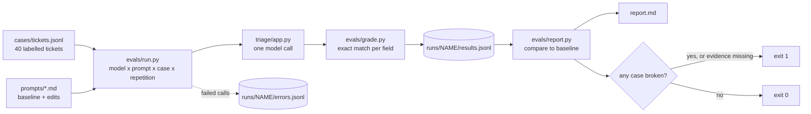

# Solution design: a regression suite for prompt changes

| | |
|---|---|
| **Owner** | Lawrence Dass |
| **Status** | In review |
| **Created** | 2026-11-12 |
| **Last reviewed** | 2026-11-12 |
| **Problem** | [PROBLEM.md](PROBLEM.md) (Approved) |
| **How to run** | [README.md](README.md) |

This document explains how the solution works and why it is built this way. Results are not in it. They go in the README once the first full run is done.

## 1. Summary

Run a fixed set of labelled tickets through the real triage code, once for the current prompt and once for each edited prompt, several times each. Grade every answer field by field. Report which tickets changed, and fail the check if any ticket that used to pass now fails, or if the evidence is incomplete.

## 2. Goals and non-goals

**Goals.** The six success criteria in [PROBLEM.md, section 9](PROBLEM.md#9-success-criteria).

**Non-goals.** Everything listed as out of scope in [PROBLEM.md, section 6](PROBLEM.md#6-scope). The suite catches regressions. It does not search for a better prompt, grade summary quality, or watch live traffic.

## 3. How it works



One **job** is a single model call, identified by four values: model, prompt version, case and repetition number. A default full run is 4 models × 5 prompt versions × 40 cases × 3 repetitions, which is 2,400 jobs.

## 4. Components

| Component | File | Responsibility |
|---|---|---|
| Labelling policy | `LABELING_POLICY.md` | The written rules that define a correct answer |
| Test cases | `cases/tickets.jsonl` | One JSON line per ticket: id, tags, text, expected values |
| Case loader | `evals/cases.py` | Loads the cases and rejects a malformed file before any call is made |
| Prompts | `prompts/*.md` | `v1_baseline.md` and one file per edit. Each edit is the baseline with one change |
| Output contract | `triage/schema.py` | The JSON Schema sent to the API, and the Pydantic model used to check the reply |
| The feature | `triage/app.py` | `triage_ticket()`: the single model call a product would ship, with one implementation per provider |
| Grader | `evals/grade.py` | Compares one output with one expected answer. No model calls |
| Runner | `evals/run.py` | Schedules jobs, writes one row per finished job, logs failed calls separately, writes the run manifest |
| Report | `evals/report.py` | Pass rates overall and per tag, per-field accuracy, wrong answers counted by pattern, cases that changed, and the gate |
| Review simulation | `evals/review.py` | Applies a review rule to a finished run and counts the wrong answers it catches and misses. No model calls |
| Agreement check | `evals/agreement.py` | Compares a second person's blind labels with the expected answers |
| Case viewer | `evals/render_cases.py` | Generates `CASES.md` so the test set can be reviewed without reading JSON |

## 5. Design decisions

Each decision lists what was chosen, why, and what was turned down.

### 5.1 The suite calls the production function

`evals/run.py` calls `triage_ticket()` from `triage/app.py` and nothing else.

*Why:* a test copy of the prompt or the call would drift from the real one, and the suite would then be measuring something that does not ship.

*Turned down:* comparing recorded outputs only, as the reference project this draws on does. That is cheaper and deterministic, but it cannot test a prompt nobody has run yet.

### 5.2 A JSON Schema on the request, then our own validation

The request carries a JSON Schema, so the API returns JSON of the right shape. The reply is still validated with Pydantic on our side.

*Why:* the schema removes a whole class of failure (unparseable replies), which leaves the suite measuring one thing: whether the values are right. Validating again costs nothing and means a contract mismatch is recorded as `invalid`, not as a crash.

*Turned down:* asking for JSON in the prompt and parsing free text. That mixes formatting failures with judgement failures in the same score.

Both vendors support this. Anthropic takes the schema in `output_config.format`, OpenAI in the Responses API's `text.format` with `strict: true`. OpenAI's strict mode writes a nullable field as a type list, so `triage/schema.py` keeps a second copy of the schema that differs only in how `invoice_id` allows null. The Pydantic check on our side is the same for both.

### 5.3 Exact match on four fields, and all four must be right

`category`, `urgency`, `refund_requested` and `invoice_id` are compared for equality. A case passes only when all four match.

*Why:* each field has a small closed set of valid answers, so equality measures the answer and not the wording. A ticket with the right category and the wrong urgency still reaches the wrong person, so partial credit would overstate how well a prompt works.

*Turned down:* an LLM judge. It adds cost, a second source of variation, and a grader that itself needs checking. Nothing in these four fields needs judgement to grade.

The per-field results are kept, so the report can show which field went wrong.

### 5.4 The summary is checked for length only

*Why:* a summary has many valid wordings. Grading it properly needs a judge, which section 5.3 rules out. Length is the one property that can be checked exactly. It is reported in its own column and does not affect pass or fail.

### 5.5 Every case runs three times

*Why:* these models reject a temperature setting, so the same ticket can be answered differently on two calls. One run cannot tell a regression from chance.

*Turned down:* one run per case. It is three times cheaper and its results cannot be trusted.

Three is a starting point, not a derived number. See open question 1.

### 5.6 What counts as broken

For each case, the report computes the share of repetitions that passed, on the baseline and on the edited prompt.

| Baseline | Edited prompt | Label |
|---|---|---|
| Passed every time | Passed fewer than half | **broken** |
| Failed every time | Passed more than half | **fixed** |
| Same share | Same share | same |
| Anything else | | **flaky** |

*Why:* "broken" should mean something a reviewer can act on. Requiring a clean baseline and a majority of failures keeps single unlucky calls out of that list. Flaky cases are still listed, because a case that became unreliable is worth a look.

### 5.7 Failed calls go to a separate file

A timeout, an API error, a reply cut off at the token limit, or a reply served by a different model than the one requested is written to `errors.jsonl`. It never gets a row in `results.jsonl`.

*Why:* these are failures of plumbing, not of the prompt. Scoring them as wrong answers would blame an edit for a rate limit. Keeping them out of the results file also means the next run retries them automatically.

A refusal is different. It is the model's answer to the ticket, so it is recorded in the results as a failed case.

### 5.8 Resumable by job key

Before starting, the runner reads `results.jsonl` and skips every job that already has a row. Rows are appended as each job finishes.

*Why:* a crash or a rate limit part-way through 1,200 calls should cost nothing already paid for, and a rerun must not create two rows for the same job.

### 5.9 No model fallback

The request does not enable server-side fallback to another model.

*Why:* a fallback would let a different model answer silently. The suite compares prompts on a named model, so the model has to stay fixed. The runner also checks the model named in each reply, for both vendors, and treats a mismatch as an error.

### 5.10 Four models, two vendors, low effort

The suite runs on a cheap model and a strong model from each of two vendors:

| Tier | Anthropic | OpenAI |
|---|---|---|
| Cheap, high volume | Claude Haiku 5.5 | GPT-6 Luna |
| Strong, a step below the flagship | Claude Opus 5.5 | GPT-6.1 Sol |

All four run at `low` effort, the lowest level all four accept, and all four reason before answering.

*Why:* triage is a short classification task and would run at high volume, where low effort is the realistic setting. Two tiers show whether a stronger model resists an edit that breaks a cheap one. Two vendors show whether a result is about the prompt or about one vendor's models: Haiku and Opus may fail in similar ways, and a second vendor answers that objection. Each tier is matched by position in its vendor's lineup. Prices differ: Luna and Haiku cost the same, Sol costs half what Opus does.

*Turned down:* the two flagships, Claude Fable 5.2 and GPT-6 Astra. They roughly double the cost of the run, and a company would not route support tickets through a flagship model. Neither vendor's top model is tested, and the results say nothing about them. Also turned down: a local model, whose JSON output is less reliable and would mix format failures into the results.

### 5.11 An interval next to every pass rate

The report shows a 95% interval for each pass rate, from 2,000 bootstrap resamples of the cases with a fixed seed.

*Why:* with 40 cases, a two-point difference between prompts may be nothing. The interval makes that visible beside the number.

*Turned down:* a standard binomial interval. Repetitions of the same case are not independent, so it would look narrower than it should. Resampling whole cases avoids that.

### 5.12 Plain files, no eval framework

Cases, prompts and results are JSON Lines and Markdown. The harness is about 650 lines of Python with two dependencies.

*Why:* the constraints ask for something one person can maintain and a non-engineer can add a case to. Every result row can be read and checked by hand.

*Turned down:* an eval platform. Reasonable for a team, more than this needs, and it would hide the mechanism the article is about.

### 5.13 The gate fails closed, with explicit tolerances

The gate takes two settings: the number of broken cases allowed per prompt version (default 0) and a minimum pass rate (default none). It also fails when there are no results, when the baseline was never run, when a case has no answer on the new version, and when a threshold is not a valid number.

*Why:* a decision made on missing evidence is not the same as a decision made on zero failures. The first version of this harness skipped a case silently when every call for it had failed, which would have let a bad edit through.

*Source:* stage 4 of the `prompt-regression-tester` project ("An empty suite fails closed", "missing responses are failures").

### 5.14 Every row records what it ran against

Each result row carries a fingerprint of the case text and expected answer, a fingerprint of the prompt, the effort level, the SDK version and the time of the call. Resuming a run after a case or prompt was edited is refused. The report fails the gate if a case differs between the baseline rows and the edited-prompt rows.

*Why:* comparing two prompt versions only means something if both ran against the same cases. Without a fingerprint, editing a ticket halfway through would mix old and new rows with no warning. Recording effort and SDK version matters because both can change model behaviour with no change to the prompt.

*Source:* stages 1 and 3 of the same project (hash the case list, keep model and settings beside the responses), and "Drift You Did Not Ship" in the AI System Design Guide's evaluation chapter.

### 5.15 Results are broken down by kind of case

The report shows the pass rate for each tag (tone mismatch, refund trap, invoice trap and so on) under every prompt version, beside the overall number.

*Why:* an edit can leave the overall pass rate flat while one kind of case gets worse. The tag table shows where.

*Source:* exercise 3 of the evaluation lesson in ai-engineering-from-scratch ("A system can improve overall while regressing on a specific category").

### 5.16 Wrong answers are counted by pattern

For each prompt version the report lists every kind of wrong answer with its frequency, for example "urgency: gave high, wanted low (9 calls, 4 cases)".

*Why:* a list of failed case ids says which tickets broke. It does not say what the prompt edit did. Counting the patterns turns scattered failures into a named failure mode that can be fixed and prioritised.

*Source:* the error analysis chapter of the evals study guide in the AI System Design Guide, which treats categorising and counting failures as the most important step and the one teams skip.

### 5.17 A second person can label the cases blind

`evals/agreement.py` writes a copy of the tickets with the answers blanked. Someone fills it in without seeing the expected answers, and the script reports agreement per field and lists each disagreement.

*Why:* if two people label the same ticket differently, the policy is unclear and the suite is grading against an unclear target. The study guide puts the bar at about 80% agreement before trusting a label.

*Source:* the human annotation chapter of the same study guide.

### 5.18 A review rule, simulated after the run

`evals/review.py` takes each ticket's repeated calls and decides what a production system would do with them. The answer is the majority of the calls, field by field. The ticket goes to a person when the calls disagree on a graded field, when a reply was unusable, or when the answer is `account_access`, which covers logins and possible security problems. The expected answer stands in for a reviewer who always corrects the ticket.

*Why:* in production, code decides from a confidence signal and business rules whether a person checks an answer. That decision belongs in code, not in the model's output, so a threshold can change without a prompt change. The repeated calls the suite already makes give a free confidence signal: agreement. The simulation shows how many wrong answers that signal catches, and how many get past it because the model was consistently wrong.

*Turned down:* asking the model for a confidence score. It changes the prompt and the output schema, which is itself a prompt edit and would make the run incomparable with the predictions. Self-reported scores also tend to be overconfident.

*Limits:* three calls per ticket triple the cost in production. The account_access rule is one example rule, not a tuned policy. Forty tickets can show the method but cannot set a threshold.

## 6. Data formats

**A case** (`cases/tickets.jsonl`):

```json
{"id": "t12", "tags": ["tone-mismatch"], "ticket": "Hello, hope you're well. Small thing, no rush at all: I got an email saying someone signed into my account from a device in a country I've never been to. Probably nothing? Thanks so much!", "expected": {"category": "account_access", "urgency": "high", "refund_requested": false, "invoice_id": null}}
```

**A result row** (`runs/<name>/results.jsonl`) holds the job key, the case and prompt fingerprints, effort, SDK version, timestamp, the model that served the call, the tags, the status, `passed`, a true or false per field, the expected answer, the model's output, token counts (full-rate input, cache reads, cache writes, output, and the reasoning part of output), cost and latency.

**The manifest** (`runs/<name>/manifest.json`) is rewritten at the end of every invocation. It holds the code commit and whether the folder had uncommitted changes, the model IDs requested and the ones that answered, effort, token limit, timeout and SDK version, the prices used for cost, totals across the run, and one entry per invocation with its arguments, start and finish times, call counts and cost.

**An error row** (`runs/<name>/errors.jsonl`) holds the job key, an error class (`timeout`, `rate_limit`, `api_<status>`, `connection`, `truncated`, `served_model_mismatch`) and, where the call completed, its token counts and cost.

## 7. How each part of the problem is handled

The numbers match [PROBLEM.md, section 5](PROBLEM.md#5-parts-of-the-problem).

| # | Part of the problem | Handled by | Status |
|---|---|---|---|
| 1 | No written definition of correct | `LABELING_POLICY.md`. Every expected answer must follow it | Handled |
| 2 | No fixed set of examples | 40 tagged cases, including the hard kinds | Handled |
| 3 | Valid output hides wrong output | Exact-match grading of values (5.3) | Handled |
| 4 | Edits have distant effects | Every edit is run against every case, not only related ones | Handled |
| 5 | Same input, different answers | Three repetitions and the broken/flaky rule (5.5, 5.6) | Handled. Number of repetitions unproven |
| 6 | Behaviour depends on the model | Two models, reported separately (5.10) | Handled for two models |
| 7 | Failed calls are not wrong answers | Separate errors file (5.7) | Handled |
| 8 | Cheap enough to run every time | Concurrent calls, resumable runs, cost recorded per call | Not yet measured |
| 9 | A small test set limits detection | Interval beside each pass rate (5.11) | Shown, not solved |
| 10 | Nobody owns the decision to ship | `--gate` with explicit tolerances, failing closed (5.13) | Partly. See section 9 |
| 11 | A test set goes stale | Fingerprints catch edits within a run (5.14). Nothing rotates or refreshes cases | Mostly not handled |
| 12 | Fields do not matter equally | Per-field columns in the report | Partly. The gate treats fields equally |

## 8. Success criteria

| # | Criterion | Status | Evidence |
|---|---|---|---|
| 1 | Names every changed ticket, with field and value | Met | `test_report_names_the_case_a_prompt_edit_broke` |
| 2 | Separates broken from inconsistent | Met | `test_classify` |
| 3 | Restartable without loss or double-counting | Met | `test_run_writes_one_row_per_job_and_resumes_without_duplicates` |
| 4 | Runs in CI and fails when a ticket breaks | Partly | `--gate` works and fails closed (six gate tests). CI runs the harness tests only |
| 5 | Adding a case is one line in a data file | Met | `cases/tickets.jsonl`, checked on load by `evals/cases.py` |
| 6 | Cost and duration recorded | Partly | Recorded per call. No full run yet |

The tests use a stand-in for the model. Nothing here has been run against a real model yet.

## 9. Known gaps

- **The gate does not run in CI.** A real run needs an API key and costs money, so the CI workflow runs only the harness tests. Wiring the gate into CI means storing a key as a repository secret and deciding which changes trigger a paid run.
- **Nothing keeps the test set current.** There is no process for adding cases from real failures or retiring old ones.
- **The gate does not separate fields.** One broken case of any kind fails it. The eval-gated CI case study in the AI System Design Guide gates each quality axis on its own and warns that a single combined score hides regressions on the axis that matters most. Applied here, that means a separate rule for `urgency`. This is open question 4.
- **40 cases is below what the resources recommend for a pass rate.** The evaluation lesson in ai-engineering-from-scratch says 50 cases cannot detect a 5-point change and recommends 200 or more for release decisions. This suite is built to find which individual cases changed, which works at 40. Its pass rates should be read as rough.
- **No held-out cases.** Every case is visible to whoever edits the prompt, so a prompt can be tuned to this set. The resources recommend a held-out set the prompt author never sees.
- **No cases from real traffic.** The resources describe three sources for a test set: curated cases, adversarial cases and production samples. This set has the first two.
- **The labels have been checked by one second person, once.** The blind check (5.17) on 2026-11-15 gave 80% agreement on category, 68% on urgency, 88% on refund and 95% on invoice. Every urgency disagreement rated higher than the policy. The owner kept the strict urgency rule. The round 1 file is kept unedited in `labels/blind_round1.*`; later corrections are not blind.

## 10. Testing

33 tests in `tests/test_evals.py`, none of which call a model. They cover case validation, grading, the broken/flaky/fixed rule, resuming a run, the errors file, the report naming the right case, the per-tag and wrong-answer tables, label agreement, the run manifest, the OpenAI call (parsing, refusals, cut-off replies, cached tokens), the cost formula, the review simulation, and each way the gate fails closed. The runner accepts the triage function as an argument, which is how the tests substitute a stand-in.

## 11. Cost

Prices used for cost tracking, in US dollars per million tokens, checked against each vendor's pricing page on 2026-11-15:

| Model | Input | Cache read | Cache write | Output |
|---|---|---|---|---|
| Claude Haiku 5.5 | 0.10 | 0.01 | 0.125 | 0.50 |
| Claude Opus 5.5 | 4.00 | 0.20 | 5.00 | 20.00 |
| GPT-6 Luna | 0.10 | 0.01 | 0.125 | 0.50 |
| GPT-6.1 Sol | 2.00 | 0.10 | 2.50 | 10.00 |

OpenAI caches long prompts automatically. Anthropic caches only when the request asks for it, which this harness does not do yet. Cached tokens are recorded and priced on every row either way.

A ten-call pilot on the two Claude models on 2026-11-15 cost $0.0318: about $0.00016 per call on Haiku and $0.0062 on Opus. The cost of a full run has not been measured. Each new model gets a pilot first, and the measured cost is checked against the budget before the full run.

## 12. Open questions

Carried over from [PROBLEM.md, section 10](PROBLEM.md#10-open-questions). The design currently uses the default shown.

| # | Question | Default in use |
|---|---|---|
| 1 | How many repetitions are enough? | 3 |
| 2 | Does one broken case block a change? | Yes. Now a setting (`--max-broken`), default 0 |
| 3 | Is reporting a wrong charge a refund request? | No. Decided by the owner on 2026-11-15 |
| 4 | Should fields carry different weights in the gate? | No |

## 13. What came from the resources

The three resource repos are the study material for this experiment. This table records what each contributed, so the credit is exact.

| Source | What it contributed |
|---|---|
| `prompt-regression-tester` project, ai-engineering-from-scratch | Pair results by case, because an average can stay flat while a required behaviour is lost. Validate cases before scoring. Fingerprint cases. Gate on explicit tolerances and fail closed |
| Evaluation lesson (phase 11, lesson 10), ai-engineering-from-scratch | The before-and-after regression workflow. An interval on every score. The warning that small sets cannot detect small changes |
| Eval-gated CI/CD case study, AI System Design Guide | Use code checks where the answer is deterministic and keep judges for subjective quality. Gate per axis, not on one combined score. Pin effort. Keep cases and results in files you own |
| LLM evaluation chapter, AI System Design Guide | Record model, effort and SDK version on every run, because behaviour can change with no change on your side |
| Evals study guide, AI System Design Guide (chapters 1, 3, 5 and 11 to 15) | Categorise and count failures before anything else. Have a second person label blind and measure agreement. Test the grader itself with known good and bad cases |
| Evaluation lesson exercises, ai-engineering-from-scratch | Break results down by category, because an overall score can hide a regression in one kind of case |

What this experiment does that the reference project does not: it calls a live model, repeats each case to separate regressions from chance, and keeps failed calls apart from wrong answers.

## 14. Change log

| Date | Change |
|---|---|
| 2026-11-12 | First version, describing the harness as built. No run against a model yet. |
| 2026-11-12 | Revised after reading the article 1 resources in full, which the first version was not based on. Added a fail-closed gate with tolerances (5.13) and fingerprints on every row (5.14). Added four known gaps and the table of what came from each resource. |
| 2026-11-12 | Second revision after finishing the remaining resources. Added the per-tag breakdown (5.15), wrong-answer patterns (5.16) and the blind-label agreement check (5.17). |
| 2026-11-14 | Added the run manifest (section 6) and the served model on every result row. |
| 2026-11-16 | Added the review simulation (5.18). |
| 2026-11-15 | Added two OpenAI models (5.2, 5.10, section 11). Cache reads, cache writes and reasoning tokens are recorded on every row and priced separately. |
| 2026-11-15 | Recorded the blind labelling result and the decision on open question 3 (section 9, section 12). |
